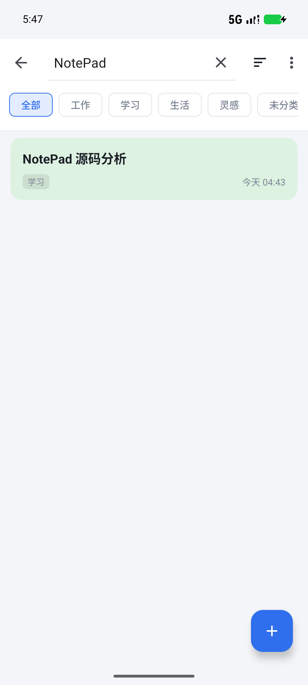

# 记事本 NotePad —— 移动软件开发期中实验

基于 Android 官方 NotePad 示例（[fjnu-cse/NotePad](https://github.com/fjnu-cse/NotePad)）完成的《移动软件开发》期中实验扩展版。在保留原有 `NotesList + NoteEditor + NotePadProvider` 架构的基础上，补充了时间戳、搜索、分类、排序、便签配色、标题编辑、整篇复制粘贴、退出前保存确认等能力。

<p align="center">
  
  
  
</p>

## 功能一览

### 基本要求

| 功能 | 说明 |
| --- | --- |
| 列表条目显示时间戳 | 每个条目在标题下方显示「2026年11月13日 14:30」格式的完整最后修改时间 |
| 笔记查询 | 标题栏搜索框，支持按**标题或正文内容**模糊查询，输入即时过滤，收起搜索框自动恢复全部列表 |

### 扩展功能

| 功能 | 说明 |
| --- | --- |
| UI 美化 | Material 3 卡片列表、圆角便签、空状态插画；编辑器保留「横线稿纸」并提升字号行距 |
| 更换便签背景 | 6 种浅色便签底色，列表卡片与编辑页整页同步变色，状态栏跟随 |
| 笔记分类 | 5 个分类（工作 / 学习 / 生活 / 灵感 / 未分类），编辑器内设置，列表顶部标签筛选 |
| 笔记排序 | 修改时间新→旧 / 旧→新 / 标题 / 分类四种方式，选择结果持久化 |
| 常驻编辑 / 删除 | 每条卡片右上角常驻「编辑」「删除」图标，删除前二次确认 |
| 标题手动设置 | 正文上方新增标题输入框，新建可填写、已有可随时修改 |
| 整篇复制 / 粘贴 | 长按卡片「复制笔记」，粘贴后完整还原标题、正文、分类与背景色 |
| 鼠标右键粘贴 | 列表空白处右键弹出浮动菜单，可直接粘贴笔记；落在条目上时额外提供复制 |
| 退出前询问保存 | 返回箭头或系统返回键触发「保存 / 不保存 / 取消」；不保存不改动修改时间 |

## 界面预览

| 按标题搜索 | 分类筛选 | 排序 |
| --- | --- | --- |
|  |  |  |

| 选择颜色 | 背景生效 | 返回询问保存 |
| --- | --- | --- |
|  |  |  |

> 部分截图拍摄于功能迭代中期（界面显示相对时间、标题输入框尚未加入），最终细节以图 01、14 为准，详见 [项目报告.md](项目报告.md) 第 7.3 节。

## 技术栈

- Java 17，`compileSdk 37` / `minSdk 24` / `targetSdk 37`
- Android Gradle Plugin 9.3.2，Gradle 9.5.0
- AndroidX AppCompat 1.6.1、Material Components 1.10.0
- ContentProvider + SQLite（`note_pad.db`，数据库版本 3）
- SharedPreferences（排序偏好、剪贴板快照备份）、系统剪贴板 + JSON 快照

## 快速开始

环境要求：JDK 17+、Android Studio、Android SDK Platform 37。

```bash
cd NotePad
./gradlew assembleDebug
# 产物：app/build/outputs/apk/debug/app-debug.apk
```

也可以直接用 Android Studio 打开 `NotePad/` 目录运行到模拟器或真机。

## 项目结构

```
android-midterm/
├── README.md                 # 仓库说明（本文件）
├── 项目报告.md                # 详细实验报告
├── screenshots/              # 14 张运行截图
└── NotePad/                  # Android 工程
    ├── app/src/main/java/com/example/android/notepad/
    │   ├── NotesList.java         # 列表页：搜索、分类筛选、排序、复制粘贴、右键菜单
    │   ├── NoteEditor.java        # 编辑页：正文、标题、分类、配色、退出确认
    │   ├── NotePad.java           # 数据契约：列名、分类、排序常量
    │   ├── NotePadProvider.java   # ContentProvider + SQLite 数据库
    │   ├── NoteUtils.java         # 时间格式化、便签配色、标题推导
    │   ├── NoteClipboard.java     # 整篇笔记复制 / 粘贴快照
    │   ├── TitleEditor.java       # 原始版本的标题编辑（保留）
    │   └── NotesLiveFolder.java   # 原始版本的 Live Folder（保留）
    ├── app/src/main/res/          # 布局、菜单、颜色、图标
    └── ...
```

## 详细文档

完整的需求分析、系统设计、关键代码与测试记录见 **[项目报告.md](项目报告.md)**。

## 说明

- 原始 AOSP NotePad 的粘贴建笔记、`TitleEditor`、Live Folder 等能力均保留可用。
- 源码文件保留了 AOSP 的 Apache License 2.0 版权头，扩展代码同样遵循该协议。
