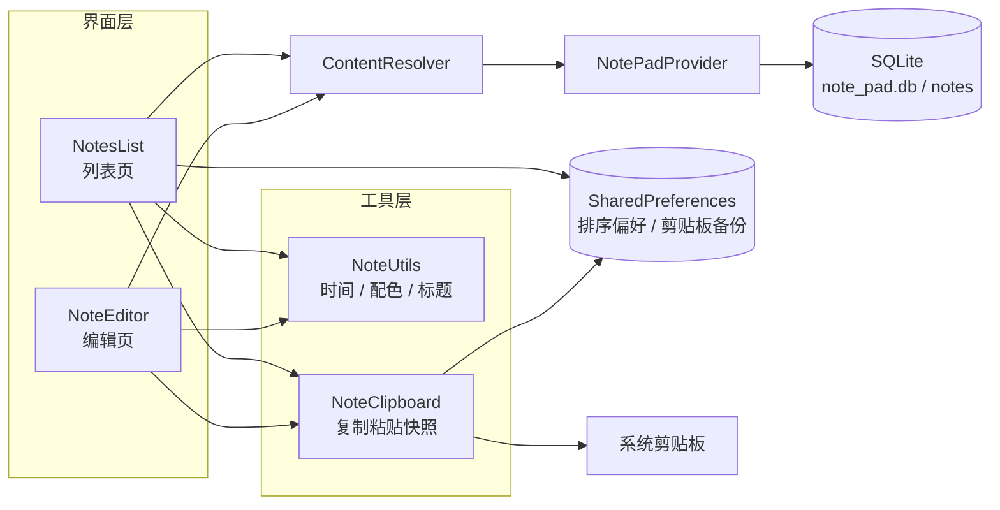
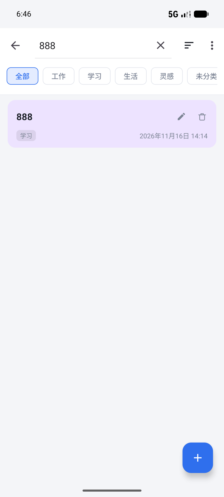
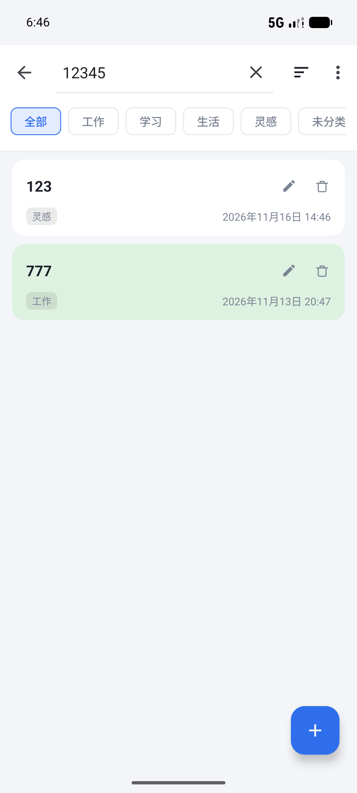
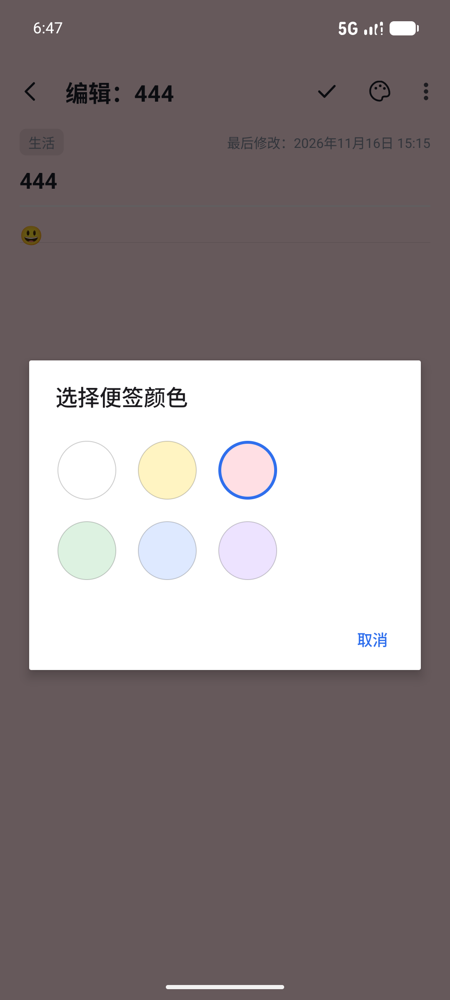

# 《移动软件开发》期中实验项目报告

> **项目名称**：记事本 NotePad（Android）  
> **基础工程**：Android 官方 NotePad 示例（[fjnu-cse/NotePad](https://github.com/fjnu-cse/NotePad)）  
> **姓名**：Chen Tao  
> **GitHub**：[@su514609](https://github.com/su514609)  
> **完成日期**：2026 年 11 月 18 日  
> **代码仓库**：<https://github.com/su514609/android-midterm>

---

## 摘要

本项目在 Android 官方 NotePad 示例的基础上完成《移动软件开发》期中实验。实验在保留原有 `NotesList + NoteEditor + NotePadProvider` 三层结构的前提下，实现了「列表条目显示完整时间戳」和「按标题 / 内容查询笔记」两项基本要求，并在此基础上扩展了便签配色、笔记分类、列表排序、常驻编辑 / 删除、标题手动编辑、整篇笔记复制粘贴、鼠标右键菜单、退出前询问是否保存等功能。

工程使用 Java 17 开发，`compileSdk 37`、`minSdk 24`，共 8 个 Java 源文件、约 3200 行代码、43 个资源文件。数据仍由 ContentProvider 封装 SQLite 存储，界面全部基于 AndroidX AppCompat 与 Material Components 实现。

---

## 一、实验目的

1. 熟悉 Android 应用的工程结构、Activity 生命周期与资源组织方式。
2. 掌握 ContentProvider + SQLite 的数据访问模式，理解 `ContentResolver` 与 `Cursor` 的配合。
3. 掌握 `ListView` / `SimpleCursorAdapter` 的使用与定制。
4. 在真实项目中综合运用 Material 组件、SharedPreferences、系统剪贴板、对话框与浮动菜单等能力。
5. 通过功能扩展与交互打磨，提升 Android 应用的可用性与界面质量。

---

## 二、需求分析与完成情况

### 2.1 基本要求

| 编号 | 要求 | 完成情况 | 实现位置 |
| --- | --- | --- | --- |
| B1 | 列表条目显示时间戳 | 已完成：标题下方显示「2026年11月13日 14:30」格式的完整时间 | [`NotesList.java`](NotePad/app/src/main/java/com/example/android/notepad/NotesList.java)、[`NoteUtils.java`](NotePad/app/src/main/java/com/example/android/notepad/NoteUtils.java) |
| B2 | 笔记查询 | 已完成：标题栏搜索框支持按标题或正文模糊查询，输入即时过滤 | [`NotesList.java`](NotePad/app/src/main/java/com/example/android/notepad/NotesList.java) `requery()` |

### 2.2 附加功能

| 编号 | 功能 | 说明 |
| --- | --- | --- |
| E1 | UI 美化 | Material 3 卡片列表、圆角便签、空状态插画；编辑器保留横线稿纸并提升字号、行距 |
| E2 | 更换便签背景 | 6 种浅色底色，列表卡片与编辑页同步变色，状态栏跟随 |
| E3 | 笔记分类 | 工作 / 学习 / 生活 / 灵感 / 未分类，编辑器内可设置，列表顶部标签可筛选 |
| E4 | 笔记排序 | 修改时间新→旧、旧→新、标题、分类四种方式，选择持久化到 SharedPreferences |
| E5 | 常驻编辑 / 删除 | 每条卡片右上角常驻图标，删除前弹出确认对话框 |
| E6 | 标题手动编辑 | 正文上方标题输入框，新建可填写、已有笔记可随时修改 |
| E7 | 整篇复制 / 粘贴 | 复制标题、正文、分类与背景色，粘贴后完整还原 |
| E8 | 鼠标右键粘贴 | 列表空白处右键弹出浮动菜单；右键落在条目上时额外提供「复制笔记」 |
| E9 | 退出前询问保存 | 返回箭头 / 系统返回键触发「保存 / 不保存 / 取消」，不保存时恢复原内容且不改时间戳 |

### 2.3 完成情况汇总

| 类别 | 数量 | 状态 |
| --- | --- | --- |
| 基本要求 | 2 项 | 全部完成 |
| 附加功能 | 9 项 | 全部完成 |
| 运行截图 | 14 张 | 见 [`screenshots/`](screenshots/) |

---

## 三、系统设计

### 3.1 总体架构

项目沿用 Android 官方 NotePad 的 ContentProvider 架构，各层职责如下：



- **界面层**：`NotesList` 负责列表展示、搜索、筛选、排序与条目操作；`NoteEditor` 负责正文、标题、分类、配色的编辑与保存。
- **工具层**：`NoteUtils` 统一时间格式化、便签配色与标题推导；`NoteClipboard` 负责整篇笔记的复制 / 粘贴。
- **数据层**：`NotePadProvider` 封装 SQLite 数据库，通过 `content://com.google.provider.NotePad/notes` 对外提供增删改查。
- **本地存储**：排序方式与剪贴板快照备份存放在 SharedPreferences 中。

### 3.2 数据模型

数据库为 `note_pad.db`，版本从原始的 2 升级到 **3**，`notes` 表结构如下：

| 字段 | 类型 | 说明 |
| --- | --- | --- |
| `_id` | INTEGER | 主键，自增 |
| `title` | TEXT | 笔记标题 |
| `note` | TEXT | 正文 |
| `created` | INTEGER | 创建时间（毫秒时间戳） |
| `modified` | INTEGER | 最后修改时间（毫秒时间戳） |
| `category` | TEXT | 扩展字段：分类，默认「未分类」 |
| `color` | INTEGER | 扩展字段：便签颜色下标（0~5），默认 0（白色） |

与原始版本相比，`NotePad.java` 中新增了 `COLUMN_NAME_CATEGORY`、`COLUMN_NAME_COLOR` 以及分类、排序常量；`NotePadProvider.java` 在 `onCreate` 中建表时增加两列，在 `onUpgrade` 中使用 `ALTER TABLE` 原地升级：

```java
if (oldVersion < 3) {
    db.execSQL("ALTER TABLE " + NotePad.Notes.TABLE_NAME + " ADD COLUMN "
            + NotePad.Notes.COLUMN_NAME_CATEGORY + " TEXT DEFAULT '"
            + NotePad.Notes.DEFAULT_CATEGORY + "'");
    db.execSQL("ALTER TABLE " + NotePad.Notes.TABLE_NAME + " ADD COLUMN "
            + NotePad.Notes.COLUMN_NAME_COLOR + " INTEGER DEFAULT 0");
}
```

原始示例的 `onUpgrade` 采用 `DROP TABLE` 重建，升级会丢失全部笔记；这里改为原地加列，保证已有数据不丢失。`insert()` 中也为新笔记补齐默认分类与颜色。

### 3.3 页面结构

**列表页（`activity_notes_list.xml`）**：`MaterialToolbar`（搜索、排序菜单）+ `ChipGroup` 分类筛选条 + `ListView` + 空状态视图 + `FloatingActionButton`。

**编辑页（`note_editor.xml`）**：`MaterialToolbar`（保存、配色、分类、撤销、删除菜单）+ 分类 / 时间信息栏 + 标题输入框 + `LinedEditText` 横线稿纸正文。

---

## 四、基本功能实现

### 4.1 列表条目显示时间戳

列表适配器 `NoteAdapter` 继承 `SimpleCursorAdapter` 并重写 `bindView()`，在一次绑定中读取标题、分类、修改时间与颜色，其中时间戳交给 `NoteUtils.formatTime()` 格式化：

```java
// NotesList.NoteAdapter#bindView
long modified = cursor.getLong(
        cursor.getColumnIndexOrThrow(NotePad.Notes.COLUMN_NAME_MODIFICATION_DATE));
time.setText(NoteUtils.formatTime(modified));
```

格式化统一使用「年-月-日 时:分」的完整格式：

```java
// NoteUtils#formatTime
private static final TimeZone DISPLAY_ZONE = TimeZone.getTimeZone("Asia/Shanghai");

public static String formatTime(long time) {
    if (time <= 0) {
        return "";
    }
    SimpleDateFormat format = new SimpleDateFormat("yyyy年M月d日 HH:mm", Locale.CHINA);
    format.setTimeZone(DISPLAY_ZONE);
    return format.format(new Date(time));
}
```

> 时区显式固定为 `Asia/Shanghai`，不依赖设备默认时区，避免模拟器时区停留在 GMT 时出现「时间早 8 小时」的问题。


### 4.2 笔记查询

搜索框通过 `SearchView` 放进标题栏菜单。输入变化时把关键字保存到 `mSearchText`，调用 `requery()` 重新查询。查询条件直接拼成 SQL 的 `WHERE` 子句交给 SQLite 执行，而不是把全部数据读进内存再过滤：

```java
// NotesList#requery
if (!TextUtils.isEmpty(mSearchText)) {
    selection.append("(")
            .append(NotePad.Notes.COLUMN_NAME_TITLE).append(" LIKE ? OR ")
            .append(NotePad.Notes.COLUMN_NAME_NOTE).append(" LIKE ?)");
    String like = "%" + mSearchText + "%";
    args.add(like);
    args.add(like);
}

Cursor cursor = getContentResolver().query(
        NotePad.Notes.CONTENT_URI,
        PROJECTION,
        selection.length() == 0 ? null : selection.toString(),
        args.isEmpty() ? null : args.toArray(new String[0]),
        currentSortOrder());
```

- 关键字使用参数化 `LIKE ?`，避免 SQL 注入。
- `title LIKE ? OR note LIKE ?` 同时匹配标题与正文。
- 搜索框收起（`onMenuItemActionCollapse`）时清空关键字并恢复完整列表。

| 按标题搜索 | 按内容搜索 |
| --- | --- |
|  |  |

---

## 五、扩展功能实现

### 5.1 界面美化

- 列表条目改为卡片式布局，使用便签颜色作为卡片底色，显示标题、时间、分类，并在右上角常驻编辑 / 删除图标。
- 列表空时显示插画与提示文字；搜索无结果时提示「没有找到符合条件的笔记」。
- 编辑页保留原始「横线稿纸」效果，加大字号（17sp）与行距，横线改为极浅灰色以适配彩色底。

### 5.2 更换便签背景

`NoteUtils` 中定义 6 种浅色便签底色，`color` 字段保存颜色下标。编辑器菜单中的「背景颜色」弹出圆形色板，选中后立即生效并写库：

```java
// NoteEditor#applyNoteColor
int color = NoteUtils.noteColor(mColorIndex);
mRoot.setBackgroundColor(color);
mToolbar.setBackgroundColor(color);
mText.setBackgroundColor(color);
mText.setLineColor(mColorIndex == 0 ? 0x33000000 : 0x26000000);
getWindow().setStatusBarColor(color);
```

列表侧在 `bindView()` 中通过 `BackgroundTintList` 同步卡片底色，因此编辑器改色后返回列表即可看到效果。

| 选择颜色 | 背景生效 |
| --- | --- |
|  |  |

### 5.3 笔记分类

分类常量集中在 `NotePad.Notes.CATEGORIES` 中（工作 / 学习 / 生活 / 灵感 / 未分类）。编辑器菜单提供单选对话框，选择后只更新 `category` 字段；列表顶部用 `ChipGroup` 生成「全部 + 5 个分类」筛选标签，选中后把分类名作为 `category = ?` 条件拼进查询。

| 设置分类 | 分类筛选 |
| --- | --- |
|  |  |

### 5.4 笔记排序

`NotePad.java` 定义四种排序子句，`NotesList` 用 `SharedPreferences("notepad_settings")` 的 `sort_order` 键保存用户选择：

```java
public static final String SORT_MODIFIED_DESC = "modified DESC";
public static final String SORT_MODIFIED_ASC  = "modified ASC";
public static final String SORT_TITLE_ASC     = "title COLLATE LOCALIZED ASC";
public static final String SORT_CATEGORY_ASC  = "category ASC, modified DESC";
```

排序作为 `ContentResolver.query()` 的 `sortOrder` 参数下发给 Provider，选择结果持久化，下次打开应用仍保持。


### 5.5 条目常驻编辑 / 删除

原始版本需要长按条目弹出上下文菜单。本次在卡片右上角常驻两个 `ImageButton`：

- 编辑：`openNote(id)` → 以 `ACTION_EDIT` 打开编辑器；
- 删除：先弹出确认对话框，确认后 `ContentResolver.delete()` 并刷新列表。

由于条目内含有可点击图标，`ListView` 会把整行点击判定为不可用，因此卡片点击 / 长按直接绑定在卡片视图上（见 `NoteAdapter#bindView`），不再依赖 `OnItemClick`。

### 5.6 标题手动设置与修改

编辑页正文上方新增 `EditText` 标题输入框：

- 新建笔记时数据库里的默认占位标题（`untitled`）在界面上显示为空，由 hint 提示输入；
- 保存时标题以输入框内容为准；未填写时用正文首行前 30 个字符推导（`NoteUtils.deriveTitle()`）；
- 编辑已有笔记时点标题框即可修改，`onPause` 中只有在正文或标题真正变化时才写库。

| 新建笔记 | 编辑器 |
| --- | --- |
|  |  |

### 5.7 整篇笔记复制 / 粘贴

原始版本的复制只把 `content://` URI 放进剪贴板，粘贴时回查数据库，只能恢复标题和正文，分类与颜色会丢失，原笔记删除后也无法粘贴。本次改为「快照」方案（`NoteClipboard`）：

1. 复制时把 `title`、`note`、`category`、`color` 打包成 JSON；
2. 剪贴板第一条放可读文本（标题 + 正文），粘贴到其他应用时仍是正常文字；
3. 第二条放带 `##NOTEPAD_NOTE_V1##` 前缀的完整快照；
4. 同时把快照备份到 `SharedPreferences("notepad_clipboard")`。

部分模拟器会把剪贴板与主机同步并裁剪成单条，此时粘贴时用文本比对找回备份快照，保证分类与背景色不丢：

```java
// NoteClipboard#readSnapshot（节选）
String savedText = prefs.getString(KEY_TEXT, null);
String savedPayload = prefs.getString(KEY_PAYLOAD, null);
if (savedText != null && savedPayload != null && savedText.equals(clipText)) {
    return parse(savedPayload);
}
```

粘贴时优先使用快照；若剪贴板里只是普通文本，则把文字作为一篇新笔记插入，标题自动从首行推导。

**长按与右键**：

- 长按卡片只弹「复制笔记」；
- 在列表空白处按鼠标右键，`dispatchGenericMotionEvent()` 捕获 `BUTTON_SECONDARY`，在落点弹出「粘贴笔记 / 新建笔记」浮动菜单；右键落在条目上时额外提供「复制笔记」；
- 350ms 去重，避免一次右键弹出两个菜单。

```java
// NotesList#dispatchGenericMotionEvent
@Override
public boolean dispatchGenericMotionEvent(MotionEvent ev) {
    if (isSecondaryButtonPress(ev)) {
        showBlankMenu((int) ev.getRawX(), (int) ev.getRawY());
        return true;
    }
    return super.dispatchGenericMotionEvent(ev);
}
```

> 长按与右键菜单均为自绘的 `PopupWindow` 浮动菜单，长按场景只构建「复制笔记」一项；右键落在空白处时构建「粘贴笔记 / 新建笔记」，落在条目上时额外加入「复制笔记」。


### 5.8 退出前询问是否保存

编辑页的返回箭头与系统返回键统一走 `confirmExit()`：

1. 正文、标题与进入界面时相比没有变化 → 直接退出；
2. 有变化 → 弹出「保存 / 不保存 / 取消」；
3. 选「保存」→ `saveAndFinish()`，写回正文、标题并刷新 `modified`；
4. 选「不保存」→ `discardAndFinish()`：
   - 编辑已有笔记：`restoreOriginal()` **只回写 `note` 与 `title` 两列**，不碰 `modified`，所以时间戳保持原值；
   - 新建笔记：删除这条尚未真正保存的空记录；
   - 设置 `mDiscardChanges = true`，让随后的 `onPause()` 跳过自动保存。

```java
// NoteEditor#restoreOriginal
ContentValues values = new ContentValues();
values.put(NotePad.Notes.COLUMN_NAME_NOTE,
        mOriginalContent == null ? "" : mOriginalContent);
values.put(NotePad.Notes.COLUMN_NAME_TITLE,
        mOriginalTitle == null ? "" : mOriginalTitle);
getContentResolver().update(mUri, values, null, null);
```

此外，`onPause()` 中的自动保存也做了判断：只有正文或标题真正改变时才写库，避免「打开笔记看一眼就刷新了时间戳」。


---

## 六、关键问题与解决方案

| 问题 | 原因分析 | 解决方案 |
| --- | --- | --- |
| 界面时间比真实时间早 8 小时 | 数据库存的是 UTC 毫秒时间戳，部分模拟器 / 刷机包默认时区停在 GMT | `NoteUtils` 显式指定 `Asia/Shanghai` 时区格式化，不依赖设备时区 |
| 打开笔记后时间戳被刷新 | 原始 `onPause` 无条件写回修改时间 | 对比进入界面时的正文与标题，只有真正变化才写库 |
| 选「不保存」后时间戳仍被改动 | `onPause` 在 `finish()` 之后仍会执行 | 增加 `mDiscardChanges` 标记，`onPause` 直接跳过；恢复内容时只更新两列 |
| 数据库升级导致旧笔记丢失 | 原始 `onUpgrade` 使用 `DROP TABLE` 重建 | 改用 `ALTER TABLE ... ADD COLUMN` 原地升级 |
| 条目内按钮导致整行不可点击 | `ListView` 检测到可点击子控件后把行点击判定为不可用 | 把点击 / 长按绑定在卡片视图上，不依赖 `OnItemClick` |
| 模拟器剪贴板只剩第一条 | 模拟器与主机剪贴板同步时裁剪多条目 | 完整快照备份到 SharedPreferences，粘贴时用文本比对找回 |
| 鼠标右键不触发菜单 | 右键走 `ACTION_BUTTON_PRESS`，部分设备只上报 `ACTION_DOWN` | `dispatchGenericMotionEvent` 同时判断两种 action 与 `BUTTON_SECONDARY`，并做 350ms 去重 |
| 返回键与返回箭头行为不一致 | Toolbar 与系统返回键是两套入口 | 统一调用 `confirmExit()`，并注册 `OnBackPressedCallback` |

---

## 七、测试与验证

### 7.1 功能测试

在 Android 模拟器上按功能逐项验证，结果如下（截图见 [`screenshots/`](screenshots/)）：

| 编号 | 测试项 | 操作步骤 | 预期结果 | 结果 |
| --- | --- | --- | --- | --- |
| T1 | 列表时间戳 | 新建 / 修改笔记后返回列表 | 标题下方显示完整年月日与时分 | 通过（图 01） |
| T2 | 按标题搜索 | 在搜索框输入标题关键字 | 列表即时过滤出匹配笔记 | 通过（图 02） |
| T3 | 按内容搜索 | 输入只出现在正文中的关键字 | 能搜到对应笔记 | 通过（图 03） |
| T4 | 分类筛选 | 点击顶部分类标签 | 只显示该分类笔记 | 通过（图 04） |
| T5 | 笔记排序 | 切换四种排序方式 | 列表顺序按选择变化，重启后保持 | 通过（图 05） |
| T6 | 编辑器信息 | 打开已有笔记 | 显示分类、修改时间、标题与正文 | 通过（图 06） |
| T7 | 选择颜色 | 编辑器菜单 → 背景颜色 | 弹出色板，选中后整页变色 | 通过（图 07） |
| T8 | 背景同步 | 改色后返回列表 | 列表卡片同步显示新底色 | 通过（图 08） |
| T9 | 编辑器菜单 | 打开编辑器菜单 | 显示保存、配色、分类、撤销、删除 | 通过（图 09） |
| T10 | 设置分类 | 编辑器菜单 → 分类 | 选择后顶部信息栏更新 | 通过（图 10） |
| T11 | 新建笔记 | FAB / 菜单新建，填写标题与正文 | 保存后出现在列表 | 通过（图 11） |
| T12 | 空状态 | 删除全部笔记或搜索无结果 | 显示对应空状态提示 | 通过（图 12） |
| T13 | 长按复制 | 长按笔记卡片 | 弹出仅含「复制笔记」的浮动菜单 | 通过（图 13） |
| T14 | 退出询问保存 | 修改内容后点返回 | 弹出「保存 / 不保存 / 取消」 | 通过（图 14） |
| T15 | 整篇粘贴 | 复制后右键空白处粘贴 | 标题、正文、分类、颜色完整还原 | 通过 |
| T16 | 不保存恢复 | 修改后返回选「不保存」 | 内容恢复原样，时间戳不变 | 通过 |

### 7.2 构建与运行

**环境要求**：JDK 17+、Android Studio、Android SDK Platform 37。

**构建命令**：

```bash
cd NotePad
./gradlew assembleDebug
```

产物位于 `NotePad/app/build/outputs/apk/debug/app-debug.apk`。也可以直接用 Android Studio 打开 `NotePad/` 目录运行到模拟器（建议 API 24 及以上）。

### 7.3 说明

- 工程中保留了官方示例自带的 `androidTest` 用例（`NotePadActivityTest`、`NotePadProviderTest`），其基于已废弃的 `android.test` 框架，主要作为原始代码的参考，未纳入本次功能验证。
- 本次功能验证以模拟器人工操作为主，所有截图均为实际运行截图。

---

## 八、总结与展望

本次实验在官方 NotePad 的基础上完成了从「能用的示例」到「可日常使用的记事本」的扩展，覆盖了数据存储、列表展示、搜索筛选、编辑交互、剪贴板与生命周期处理等多个 Android 核心知识点。实现过程中感受最深的三点：

1. **数据层的小改动会影响全局**：新增分类与颜色字段需要同步修改数据契约、Provider 建表 / 升级、插入默认值、列表投影与编辑器读写，任何一处遗漏都会导致空值或崩溃。
2. **生命周期与自动保存需要谨慎设计**：`onPause` 的自动保存虽然方便，但会带来「打开即刷新时间戳」「不保存仍写库」等问题，最终通过「差异判断 + 丢弃标记 + 定点恢复」解决。
3. **交互细节决定体验**：常驻按钮、右键菜单、退出确认、剪贴板快照等看似细小的功能，实际最能体现应用的完成度。

后续可以继续改进的方向：

- 增加笔记置顶、标签多选筛选与关键词高亮；
- 引入 `RecyclerView` + `DiffUtil` 提升长列表性能；
- 增加导出 / 导入（Markdown、JSON）与自动备份；
- 适配深色模式与平板双栏布局。

---

## 附录 A 项目结构

```text
android-midterm/
├── README.md                     # 仓库说明
├── 项目报告.md                    # 本报告
├── screenshots/                  # 14 张运行截图
│   ├── 01_笔记列表_时间戳.png
│   ├── 02_按标题搜索.png
│   ├── 03_按内容搜索.png
│   ├── 04_分类筛选.png
│   ├── 05_笔记排序.png
│   ├── 06_编辑器.png
│   ├── 07_选择便签颜色.png
│   ├── 08_更换背景效果.png
│   ├── 09_编辑器菜单.png
│   ├── 10_设置分类.png
│   ├── 11_新建笔记.png
│   ├── 12_空状态提示.png
│   ├── 13_长按菜单.png
│   └── 14_返回询问保存.png
└── NotePad/                      # Android 工程
    ├── app/
    │   ├── build.gradle
    │   └── src/
    │       ├── main/
    │       │   ├── AndroidManifest.xml
    │       │   ├── java/com/example/android/notepad/
    │       │   │   ├── NotesList.java        # 762 行
    │       │   │   ├── NoteEditor.java       # 845 行
    │       │   │   ├── NotePadProvider.java  # 784 行
    │       │   │   ├── NotePad.java          # 197 行
    │       │   │   ├── NoteClipboard.java    # 244 行
    │       │   │   ├── NoteUtils.java        # 89 行
    │       │   │   ├── TitleEditor.java      # 180 行
    │       │   │   └── NotesLiveFolder.java  # 113 行
    │       │   └── res/                      # 布局、菜单、颜色、图标等 43 个资源文件
    │       └── androidTest/                  # 官方示例自带的测试用例
    ├── build.gradle
    ├── settings.gradle
    └── gradle/                               # Gradle Wrapper（9.5.0）
```

## 附录 B 截图索引

| 编号 | 文件 | 内容 |
| --- | --- | --- |
| 01 | `01_笔记列表_时间戳.png` | 列表条目与完整时间戳 |
| 02 | `02_按标题搜索.png` | 按标题搜索 |
| 03 | `03_按内容搜索.png` | 按正文内容搜索 |
| 04 | `04_分类筛选.png` | 分类标签筛选 |
| 05 | `05_笔记排序.png` | 排序方式选择 |
| 06 | `06_编辑器.png` | 编辑器整体界面 |
| 07 | `07_选择便签颜色.png` | 圆形色板对话框 |
| 08 | `08_更换背景效果.png` | 便签底色生效 |
| 09 | `09_编辑器菜单.png` | 编辑器工具栏菜单 |
| 10 | `10_设置分类.png` | 分类单选对话框 |
| 11 | `11_新建笔记.png` | 新建笔记界面 |
| 12 | `12_空状态提示.png` | 空列表提示 |
| 13 | `13_长按菜单.png` | 长按复制菜单 |
| 14 | `14_返回询问保存.png` | 退出前保存确认 |

---

*本项目的原始代码来自 Android Open Source Project 的 NotePad 示例，遵循 Apache License 2.0；扩展部分同样遵循该协议。*
